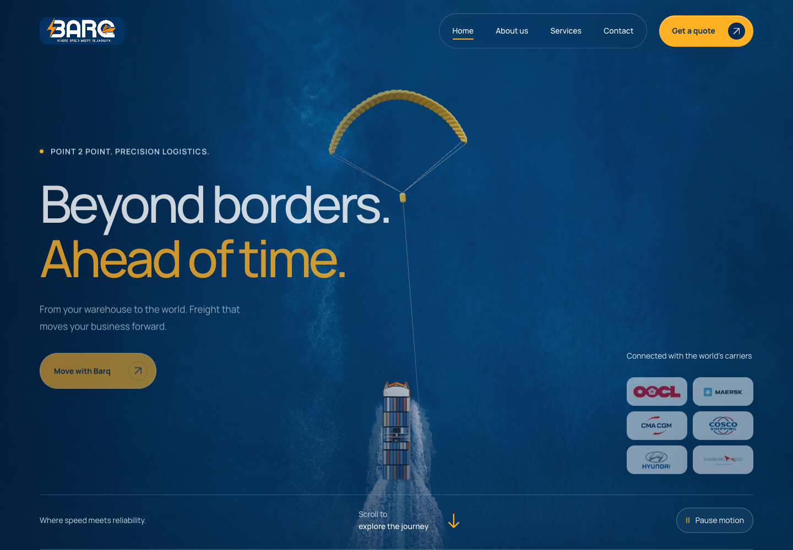

# BarqCargo

A six-page logistics website with scroll-driven motion, responsive layouts, and locally served 3D cargo scenes.

[Live demo](https://awanafnan17.github.io/BarqCargo/) · [Source notes](SOURCE-NOTES.md) · [Report an issue](https://github.com/awanafnan17/BarqCargo/issues)



## What it includes

BarqCargo is a static freight website built around an ocean-film homepage, an interactive kite-and-vessel scene, and a scroll-driven company journey. The other pages cover services, company history, locations, and enquiries with the same responsive design.

The published experience includes:

- six static routes: Home, About, Services, Contact, Our network and a custom 404 page;
- two local Three.js scenes, including a Draco-compressed cargo vessel and an opening container;
- reversible, scroll-driven sequences for the fleet, company cards, service pairs, timeline and FAQs;
- responsive desktop, tablet and mobile layouts with reduced-motion and no-script fallbacks;
- viewport-aware video and WebGL scheduling so expensive animation pauses when it is not visible;
- keyboard-accessible dialogs, navigation, native FAQ controls and clearly labelled form fields;
- an email-draft enquiry flow with no database, tracking script or secret-bearing backend.

## Technology

| Layer | Implementation |
|---|---|
| Pages | Semantic HTML generated from Python templates |
| Styling | Hand-authored responsive CSS |
| Interaction | Vanilla JavaScript and deterministic motion helpers |
| 3D | Three.js r156, GLTFLoader, DRACOLoader and local GLB assets |
| Media | Local H.264/WebP/PNG/SVG assets with graceful fallbacks |
| Content | Structured JSON plus Python section modules |
| Hosting | Static export deployed to GitHub Pages |
| Quality | Node test runner, Python integrity checks and Gitleaks |

No framework or application server is required in production. The generated `dist/` directory can be hosted by any static HTTPS provider.

## Architecture

```text
content.json + Python section modules
                  │
                  ▼
               build.py
                  │
                  ▼
  dist/ HTML, CSS, JavaScript and local media
          │                     │
          ▼                     ▼
 motion + accessible UI     Three.js scenes
          │                     │
          └──────────┬──────────┘
                     ▼
          static host / GitHub Pages
```

The animation system is intentionally split by responsibility:

- `motion-math.js` produces deterministic, reversible poses.
- `sequences.js` maps scroll progress to narrative stages.
- `hero-experience.js` manages film playback and visual parallax.
- `archived-vessels.js` owns the full-vessel Three.js experience.
- `cargo-3d.js` owns the opening-container scene.
- `app.js` coordinates navigation, dialogs, forms, loading and one shared motion clock.

## Run locally

Requirements: Python 3.9 or newer and a modern browser with WebGL support.

### macOS or Linux

```bash
python3 serve.py
```

### Windows

```powershell
py -3 serve.py
```

Open `http://localhost:8080/`. The convenience launchers `START-MAC-LINUX.command` and `START-WINDOWS.bat` do the same thing. Use `--port 8081` if port 8080 is occupied.

Serve the project through HTTP instead of opening `index.html` directly; root-relative routing and 3D asset loading require an HTTP origin.

## Develop and build

Edit `content.json`, `hero_sections.py`, `motion_sections.py` or the page templates in `build.py`, then regenerate the site:

```bash
python3 build.py
```

CSS and JavaScript under `dist/` are versioned authored files and may be edited directly. To self-host, upload the contents of `dist/` to the root of a static host. `netlify.toml` already points at that directory.

The GitHub Pages workflow creates a project-path-safe copy without modifying the verified root-host export:

```bash
python3 tools/prepare-pages.py --base-path /BarqCargo
```

## Validation

Run the same checks used before deployment:

```bash
python3 serve.py --verify-only
node --test tests/*.test.js
```

The current verified export checks all 41 published files and covers:

- 1,001 forward and reverse scroll poses;
- both decoded GLB scenes and 156 container instances;
- camera stability, pointer/keyboard movement and full-kite framing;
- video autoplay recovery, visibility pausing and reduced motion;
- route, fragment, label, dialog and local-asset integrity;
- source-wordmark removal and opaque BarqCargo hull branding.

## Privacy and deployment safety

This repository contains no database dump, hosting credential, analytics token or API key. Environment files, credentials, databases and deployment state are excluded by `.gitignore`, and the repository is scanned for secrets before release.

The enquiry form opens a pre-addressed draft in the visitor's email application. It does not transmit or store form data. Some approved business photographs, partner logos and Google Fonts are loaded from their documented public origins; see `asset-manifest.json` and [SOURCE-NOTES.md](SOURCE-NOTES.md).

## Project status

The v10 static export builds and passes the checks above. Testimonials are clearly labelled as sample content until approved client quotes are supplied. The business owner should confirm all content and commercial claims before a production launch.

## Author

Built by [Afnan Mehmood Awan](https://github.com/awanafnan17).

